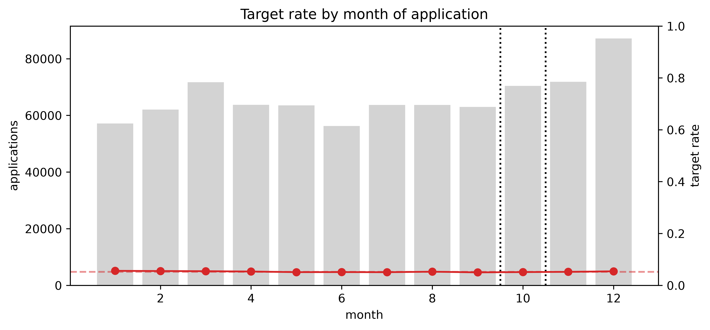
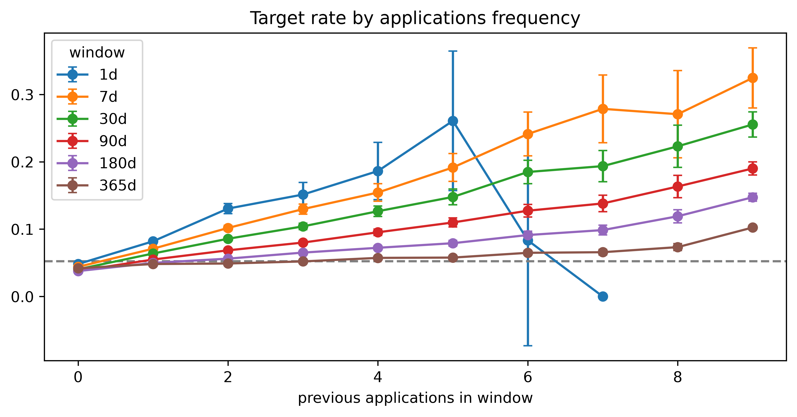
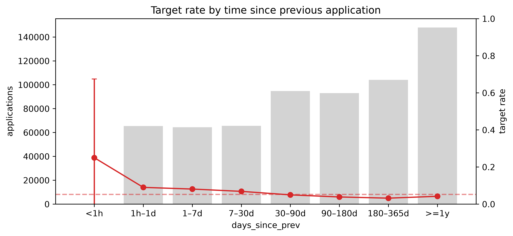
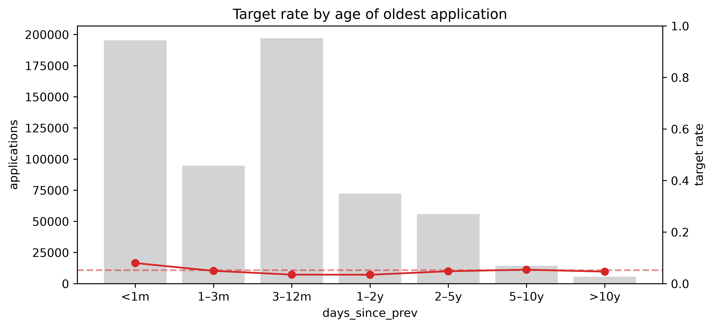
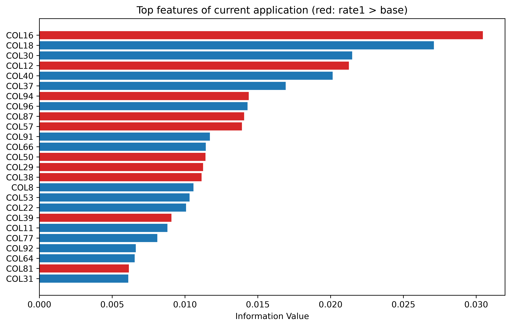
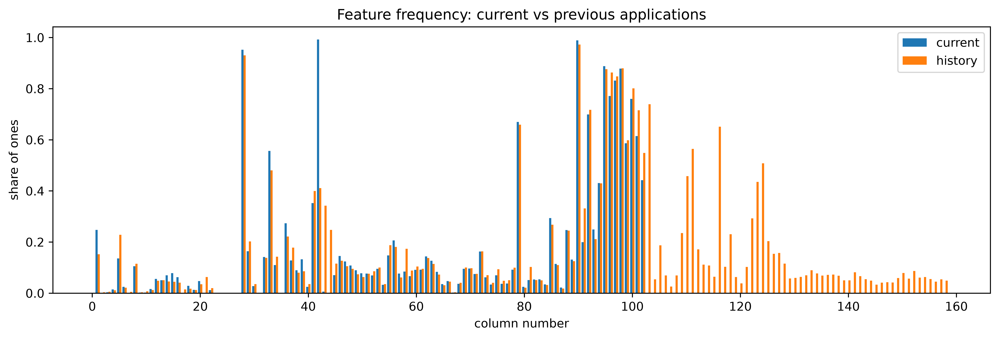

# EDA: скоринг кредитных заявок

Код: [`notebooks/01_data_loading.ipynb`](../notebooks/01_data_loading.ipynb),
[`notebooks/02_eda.ipynb`](../notebooks/02_eda.ipynb).

## Данные

- 794 201 заявка (`IDX`) с бинарным таргетом `TRG`, доля положительного класса 5,3%.
- 5 090 423 строки: для каждой заявки от 2 до 10 строк (`NUM`).
  `NUM = 0` — текущая заявка, `NUM ≥ 1` — предыдущие заявки клиента по убыванию даты.
- `COL0` — дата заявки, `COL1–COL158` — бинарные признаки.
- История обрезана: максимум 9 предыдущих заявок.

**Загрузка.** CSV (1,7 ГБ) потоково конвертируется в parquet (91 МБ) с явной схемой
`UInt8` для признаков. В памяти 850 МБ против ~6,4 ГБ при автоматическом выводе `Int64`.

**Целостность.** Нет пропусков, все признаки строго 0/1, `NUM` идёт подряд с 0,
даты строго убывают по `NUM`, совпадающих дат внутри клиента нет,
метки и данные соотносятся 1:1.

## Схема валидации

Текущие заявки распределены по 2018 году, поэтому используем out-of-time разбиение:

| Сплит | Месяцы | Заявок | Доля | Доля таргета |
|---|---|---|---|---|
| train | янв–сен | 564 718 | 71,1% | 5,27% |
| val | окт | 70 432 | 8,9% | 5,11% |
| test | ноя–дек | 159 051 | 20,0% | 5,32% |

Связь признаков с таргетом анализируется только на train + val.

## 1. Таргет, время и утечки

- Доля таргета по месяцам стабильна (5,0–5,6%), выраженного тренда нет.
  
- День недели и час подачи заявки не влияют на таргет: отклонения только в малых группах
  и в пределах доверительного интервала. В модель не включаем.
- `IDX` монотонен по времени (Spearman = 1,0), то есть это порядковый номер заявки.
  В признаки не берём.
- Точных совпадений заявок (дата до секунды + все признаки) между историями разных `IDX`
  не найдено. Утечки через повторных клиентов между train и test нет.

## 2. История заявок

| Признак | Gini |
|---|---|
| `n_prev_90d` — число заявок за 90 дней | 0,206 |
| `n_prev_30d` | 0,192 |
| `days_since_oldest` — возраст самой старой заявки в истории | 0,192 |
| `days_since_prev` — дней с предыдущей заявки | 0,189 |
| `n_prev_180d` | 0,182 |
| `n_prev_7d` | 0,145 |
| `n_prev_365d` | 0,116 |
| `n_prev_1d` | 0,079 |
| `n_prev` — общее число заявок | 0,021 |

- **Важно, когда были заявки, а не сколько их.** Общее число предыдущих заявок
  не связано с таргетом, а давность и частота заявок дают Gini ~0,2 каждый.
- **Плотность обращений.** Риск растёт с числом заявок в окне. При одинаковом числе
  заявок короткое окно рискованнее: кривые упорядочены 1d > 7d > … > 365d.
  Лучший одномерный Gini у окна 90 дней (компромисс между силой эффекта и охватом).
  
- Риск падает с ростом интервала с предыдущей заявки и немного растёт снова после года.
  
- Зависимость от возраста истории U-образная: максимум при истории младше месяца,
  минимум на горизонте 3–24 мес, выход к базовому уровню на 5–10 годах.
  
- Признаки сильно коррелируют между собой (короткая история ≈ всплеск заявок).

## 3. Признаки текущей заявки

- 66 из 158 колонок в текущей заявке константны, включая сплошной блок `COL103–COL158`.
- Дубликатов колонок и взаимодополняющих пар (`A = 1 − B`) нет.
- Признаки текущей заявки почти не несут сигнала: у 153 из 158 колонок IV < 0,02,
  максимум IV 0,03 (`COL16`), максимум Gini 0,06.
  
- Число единиц в строке (полнота анкеты) не связано с таргетом (AUC 0,484).

### Текущая заявка vs история

- 61 из 66 колонок, константных в текущей заявке (включая блок `COL103–COL158`),
  заполнены в прошлых заявках (частота до 0,74). Вероятно, это поля исхода заявки
  (решение, выдача, обслуживание), неизвестные на момент подачи текущей.
  5 колонок константны во всех строках.
  
- Признаки истории сильнее признаков текущей заявки:

  | Источник | Колонок с IV ≥ 0,02 | Макс. IV | Макс. Gini |
  |---|---|---|---|
  | текущая заявка | 5 | 0,03 | 0,06 |
  | хотя бы одна прошлая заявка (`any_prev`) | 35 | 0,23 | 0,22 |
  | последняя прошлая заявка (`last_prev`) | 10 | 0,11 | 0,14 |

- `any_prev` сильнее `last_prev`: полезна вся история, а не только последняя заявка.
- Сильнейшие признаки `COL43` (снижает риск, lift 0,54–0,72) и `COL44`
  (повышает, lift до 1,8) похожи на исход прошлой заявки.
- Подозрительно сильных признаков (IV > 0,5) нет. Допущение: исходы прошлых заявок
  известны на дату текущей заявки (проверить по данным нельзя).

## Выводы для моделирования (промежуточные)

1. Основной сигнал — в истории: исходы прошлых заявок (`any_prev` IV до 0,23)
   и их распределение во времени (Gini до 0,21). Признаки текущей заявки слабые (IV ≤ 0,03).
2. Двухветочная архитектура с раздельными энкодерами: текущая заявка — 92 неконстантные
   колонки; история — 153 колонки + Δt (поля исхода есть только в истории).
3. Время — ключевой сигнал: для каждой прошлой заявки подаём `log1p(дней до текущей)`
   и `log1p(интервал до соседней заявки)`. Зависимости немонотонны,
   для линейных моделей нужен биннинг.
4. Агрегаты для бейзлайнов: `n_prev_{7,30,90,180,365}d`, `days_since_prev`,
   `days_since_oldest`, `n_prev`.
5. Не используем как признаки: `IDX`, день недели и час заявки.

## TODO

- [ ] Сверить масштаб оси Y на графиках 2.3 и 2.5 (значения vs базовая доля 0,052).
- [ ] Значения AUC `IDX`/`ts` из 1.4 (наличие тренда таргета во времени).
- [ ] Исправить фильтр near-constant колонок.
- [ ] 3.5: частоты колонок в текущей заявке и в истории, сила признаков истории.
- [ ] 4: структура one-hot (восстановление категориальных полей).
- [ ] 5: сходство текущей заявки с предыдущей.
- [ ] 6: дрейф признаков train → test (PSI).
